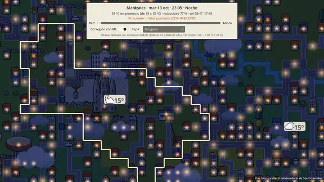
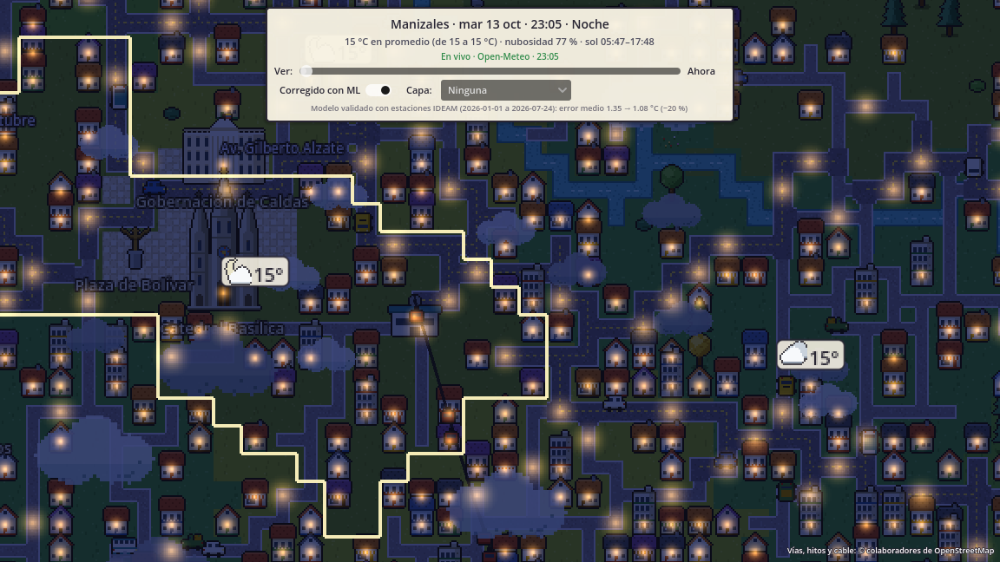
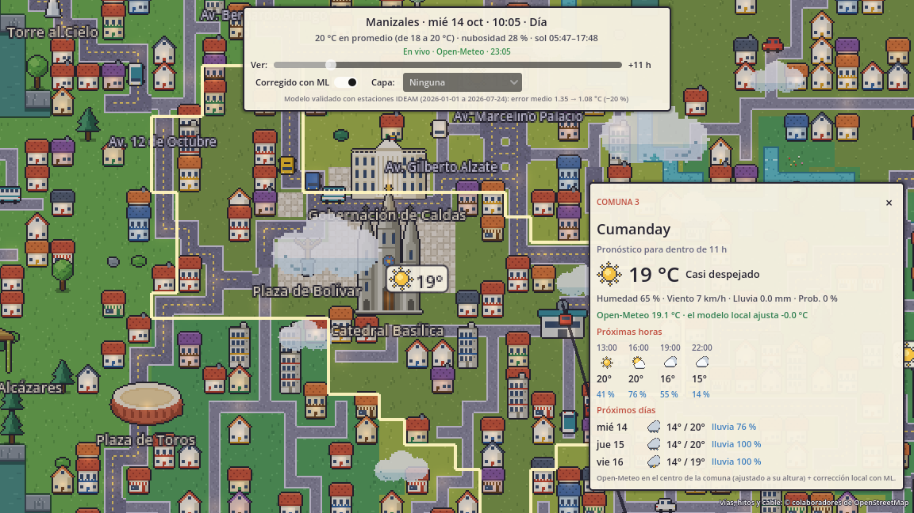
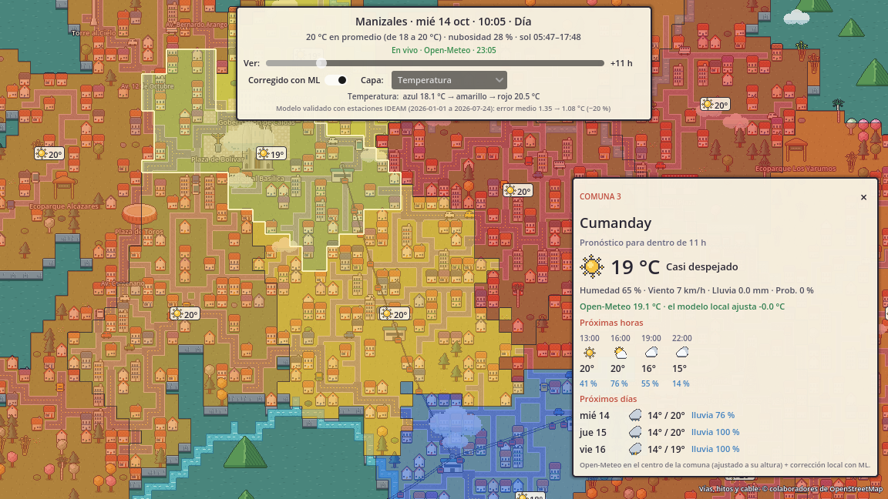
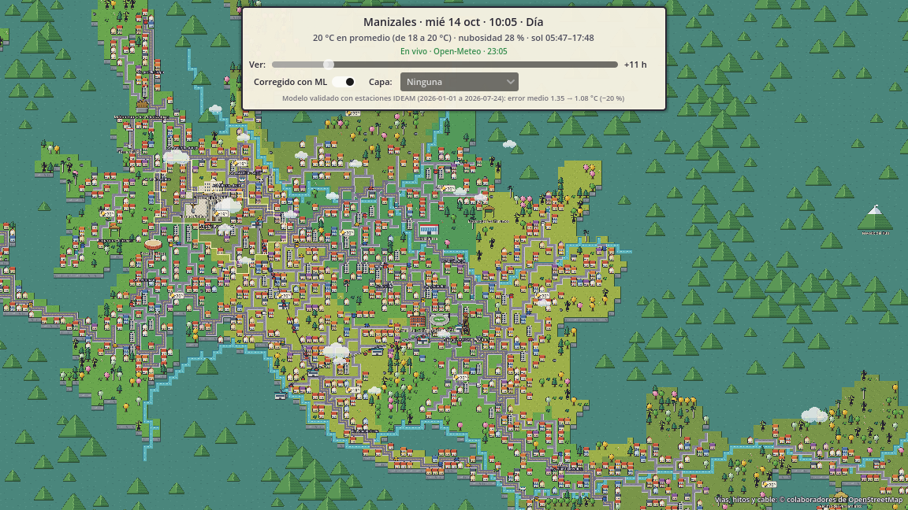
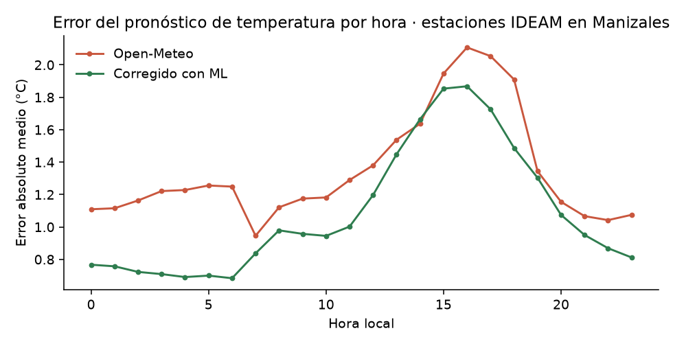
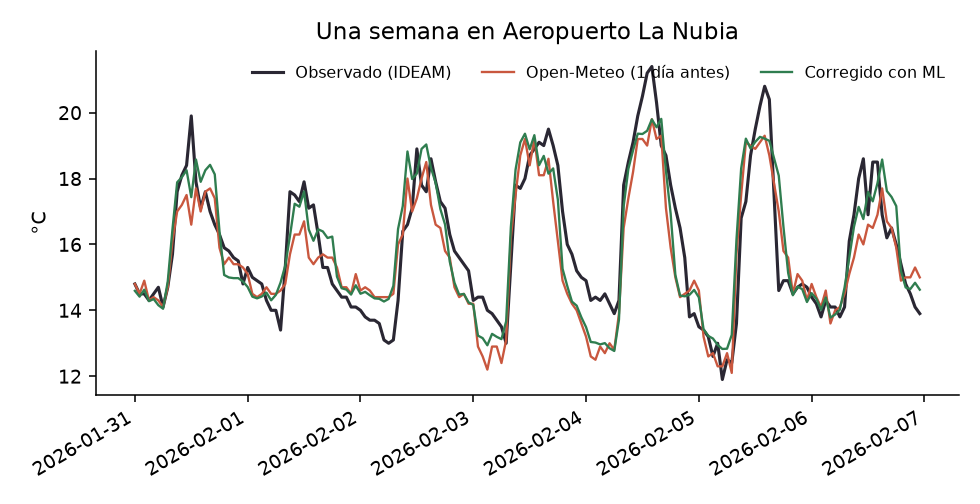

# Manizales Pixel · gemelo digital del clima

Mapa interactivo de Manizales en pixel art, hecho en **Godot 4.7**, que muestra el **clima en vivo y el pronóstico a 72 horas de cada una de sus 12 comunas**. El pronóstico se **corrige con un modelo de machine learning propio** entrenado con estaciones meteorológicas del IDEAM. El mapa reacciona al clima real: amanece y anochece a la hora real de Manizales, las farolas se encienden de noche, hay nubes y lluvia sobre las comunas donde corresponde, y el tráfico y el cable aéreo siguen su rutina.

**Demo web:** https://jersonflo.github.io/Manizales-Digital-Twin-Prototype-/



## Qué hace

| | |
|---|---|
|  |  |
| De noche: farolas y ventanas encendidas | Pronóstico por comuna (horas y días) |
|  |  |
| Capa de datos por comuna | Ciudad completa, montañas y Nevado del Ruiz |

- **12 comunas oficiales** con sus límites reales (OpenStreetMap): Atardeceres, San José, Cumanday, La Estación, Ciudadela del Norte, Ecoturística Cerro de Oro, Tesorito, Palogrande, Universitaria, La Fuente, La Macarena y Nuevo Horizonte.
- **Clima en vivo** (Open-Meteo, cada 15 min) por comuna, ajustado a la altura de cada una. Si no hay internet, usa la última respuesta guardada.
- **Selector de 0 a +72 h:** todo el mapa (luz, nubes, lluvia, insignias) pasa a la hora pronosticada.
- **Capas de datos:** temperatura, probabilidad de lluvia y cuánto ajusta el modelo de ML en cada comuna.
- **Hitos con ficha verificada:** Catedral Basílica, Gobernación, Plaza de Bolívar, Monumento a los Colonizadores, Torre al Cielo, Mall Plaza, Plaza de Toros, Estadio Palogrande, Torre de Herveo, U. Nacional, ecoparques, Bosque Popular, Recinto del Pensamiento, Nevado del Ruiz y las 7 estaciones del cable aéreo.
- **Avenidas reales con su nombre** (Kevin Ángel, Santander, Paralela, Panamericana, Centenario, 12 de Octubre…), **cable aéreo** con sus tres líneas y cabinas en movimiento, carros, árboles que se mecen y río animado.

## La parte de ciencia de datos: corregir el pronóstico global con datos locales

Los modelos meteorológicos globales tienen celdas de kilómetros y no ven el microclima de una ciudad en una ladera de los Andes. La idea es aprender cómo se equivoca el pronóstico en Manizales y restarle ese error. Es lo que en meteorología se llama post-procesamiento estadístico o MOS.

1. **Observaciones:** temperatura a 2 m de las estaciones automáticas del IDEAM *Aeropuerto La Nubia* y *Tesorito Finca* (datos.gov.co, conjunto `sbwg-7ju4`), de julio de 2024 a julio de 2026, agregadas por hora. Detalle encontrado al explorar los datos: las horas vienen en UTC. El máximo diario caía a las 18–19 h; corrigiendo a hora local (UTC−5) cae a las 13–14 h.
2. **Pronósticos:** lo que Open-Meteo pronosticó para esas mismas horas con 0, 1 y 2 días de anticipación (*Previous Runs API*), con las mismas variables que el mapa recibe en vivo.
3. **Modelo:** gradient boosting (scikit-learn) que predice el error `observado − pronosticado` a partir de la temperatura pronosticada, la humedad, la nubosidad, el viento, la lluvia, la hora del día, la época del año y la anticipación.
4. **Validación por tiempo:** se entrena con datos hasta diciembre de 2025 y se evalúa con enero–julio de 2026, nunca con una división al azar.

| Modelo (prueba ene–jul 2026, 28.734 horas) | Error medio absoluto | RMSE | Sesgo |
|---|---|---|---|
| Open-Meteo sin corregir | 1,35 °C | 1,91 °C | +0,55 °C |
| Corrección simple: sesgo medio por hora | 1,57 °C | 2,10 °C | +0,60 °C |
| Regresión lineal | 1,35 °C | 1,73 °C | +0,57 °C |
| **Gradient boosting (el que usa el mapa)** | **1,08 °C** | **1,46 °C** | **+0,38 °C** |

El modelo reduce el error medio un **19,6 %**. La mejora se mantiene con 1 y 2 días de anticipación: de 1,41 a 1,11 °C y de 1,51 a 1,12 °C. Un dato que sirve para la entrevista: la corrección "obvia" (restar el sesgo medio de cada hora) **empeora** el pronóstico en 2026, porque el sesgo cambió respecto a 2024–2025. El modelo que usa las condiciones del día sí generaliza.




**El modelo corre dentro del juego:** los 250 árboles se exportan a JSON (`data/modelo_correccion.json`) y `Scripts/clima.gd` los evalúa en GDScript sobre el pronóstico en vivo. Por eso funciona igual en el navegador, sin servidor. En el mapa se puede activar o desactivar con el interruptor *Corregido con ML*. El panel de cada comuna muestra el valor de Open-Meteo y el ajuste del modelo.

**Limitaciones:** el modelo aprende de dos estaciones del oriente de la ciudad y la corrección se aplica a todas las comunas; con más estaciones (por ejemplo, la red del IDEA de la U. Nacional) se podría aprender cómo cambia el error con la altura y la ladera. Por ahora solo se corrige la temperatura.

## Cómo está hecho

```
Reference/ (capas trazadas a mano)  ─┐
OpenStreetMap (vías, comunas, hitos) ─┼─ tools/pixelgen ─► tiles, sprites y Scenes/ManizalesPixel.tscn
                                      │   (Python sin dependencias: dibuja todo el pixel art por código)
IDEAM + Open-Meteo histórico ─────────┴─ tools/ml ───────► data/modelo_correccion.json + métricas

Godot (en ejecución): Open-Meteo en vivo ─► clima.gd (+ corrección ML) ─► clima_mapa.gd (luz, nubes, lluvia, capas)
                                                                       └► clima_ui.gd (barra, selector, panel)
```

- **Pixel art generado por código** (`tools/pixelgen/art.py`, `art_extra.py`): casas de bahareque, edificios, árboles nativos (guayacanes, yarumos, palma de cera, guadua), hitos, montañas, carros, iconos del clima. Paleta limitada y tiles de 16 px.
- **Georreferenciación** (`tools/pixelgen/georef.py`): ajusta la transformación de longitud y latitud a tiles. Primero usa marcadores identificados a mano y luego un ajuste tipo ICP de grado 2 contra las avenidas trazadas; el error medio es de 0,9 tiles.
- **Escena y tileset** escritos como texto de Godot (`build.py`), con capas `TileMapLayer`, ordenamiento por profundidad, árboles que se mecen con un shader por tile y río animado.

### Ejecutar

1. Abrir la carpeta en Godot 4.7 y ejecutar (F5). La escena principal es `Scenes/ManizalesPixel.tscn`.
2. Controles: arrastrar para moverse, rueda para el zoom, flechas o WASD; clic en un hito o en una comuna para ver su información.

### Regenerar

```bash
python tools/pixelgen/georef.py      # transformación lon/lat -> tile
python tools/pixelgen/build.py       # mapa, tiles, sprites y escena
python -m venv tools/ml/.venv && tools/ml/.venv/Scripts/pip install -r tools/ml/requirements.txt
tools/ml/.venv/Scripts/python tools/ml/descargar.py   # observaciones IDEAM + pronósticos pasados
tools/ml/.venv/Scripts/python tools/ml/entrenar.py    # modelo, métricas y gráficas
godot --path . --script res://demo/tour.gd --write-movie demo.avi --fixed-fps 30   # video de la demo
```

### Demo web

`.github/workflows/web.yml` exporta el proyecto a HTML5 con Godot en cada push a `main` y lo publica en GitHub Pages. La exportación es de un solo hilo, así que funciona en Pages sin cabeceras especiales.

## Fuentes y licencias de datos

- Vías, comunas, hitos y cable aéreo: © colaboradores de [OpenStreetMap](https://www.openstreetmap.org/copyright), ODbL.
- Clima en vivo y pronósticos pasados: [Open-Meteo](https://open-meteo.com/), CC BY 4.0.
- Observaciones de temperatura: IDEAM, [datos.gov.co](https://www.datos.gov.co/) (datos abiertos).
- Fichas de los hitos: fuentes citadas en cada ficha (`tools/pixelgen/hitos_info.py`), verificadas en octubre de 2026.
